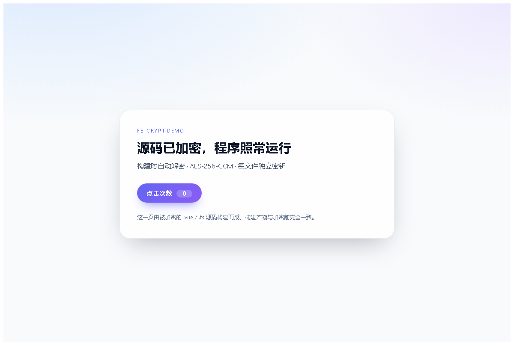

# fe-crypt

把 Vue / JS / TS 源码**原地加密**成密文，构建和开发时由插件在内存里透明解密——
仓库、硬盘、U 盘里看到的是乱码，`npm run dev` 和 `npm run build` 却照常工作，产物与加密前**逐字节一致**。

```
src/App.vue   →   /*FECRYPT:v1:q8Zk...9fA*/     ← 硬盘上是这样
                         ↓  vite 插件在内存中解密
                  <template> ... </template>     ← 编译器和浏览器看到的是原文
```



> 上图是 `demo/` 在**源码全部为密文**时 `vite dev` 的真实渲染结果（Chrome 无头截图）。

---

## 它保护什么，不保护什么

**能保护**

- 源码被直接拷走、仓库泄露、电脑丢失时，`.vue/.js/.ts` 文件本身是密文，没有密钥打不开。
- 防止"顺手翻源码"：打包前的工程文件不可读。
- 密文带 GCM 认证：改一个字节就解密失败，不会产出错误代码。
- 每文件独立随机盐 + 独立子密钥，相同内容加密结果也不同。

**不能保护**（务必理解）

- **构建产物 `dist/` 仍是明文 JavaScript**。浏览器必须拿到可执行的 JS，任何人打开 DevTools 都能看到。
  本工具保护的是"工程源码"，不是"运行时代码"。
- 不能防住能运行你项目的人（他必然拿得到密钥或解密后的代码）。
- 不要把它当 DRM 或版权保护方案。

如果目标是"连 dist 也不让人看"，需要另外做运行时分发保护（WASM、服务端渲染、代码虚拟化等），
那是另一个量级的工作，且没有绝对方案。

---

## 快速开始

### 1. 安装

本仓库目前是本地包（未发布到 npm），在**你的前端项目**里任选一种方式接入：

```bash
# 方式 A：本地路径安装（推荐，之后可正常 import 'fe-crypt/vite'）
npm i -D file:../fe-crypt

# 方式 B：全局 link
cd fe-crypt && npm link
cd ../你的项目 && npm link fe-crypt
```

```js
// 方式 C：不安装，直接引用相对路径（demo 就是这么做的）
import { feCrypt } from '../fe-crypt/src/vite.js'
```

命令行同理：

```bash
node ../fe-crypt/src/cli.js --help
# 或安装后用 npx fe-crypt / node_modules/.bin/fe-crypt
```

### 2. 初始化（设置一次密钥）

```bash
npx fe-crypt init
```

会生成 `.fecrypt/config.json`（项目盐 + 密钥校验块，**可以提交**）。
`.fecrypt/key`（可选，明文密钥文件）默认被 `.fecrypt/.gitignore` 忽略。

密钥来源优先级：

```
--key  >  --key-file  >  环境变量 FE_CRYPT_KEY  >  .fecrypt/key  >  交互式输入
```

CI / 自动化里用环境变量最方便：

```bash
export FE_CRYPT_KEY='你的密钥'      # Windows PowerShell: $env:FE_CRYPT_KEY='...'
```

### 3. 加密源码

```bash
npx fe-crypt encrypt src
```

默认处理 `src/`，扩展名 `.js .mjs .cjs .jsx .ts .mts .cts .tsx .vue`。
会自动跳过：`node_modules`、`dist`、`.git`、`vite.config.*`、`tsconfig*.json`、`*.d.ts` 等。

加密前建议先 `git commit`，方便随时 `git checkout` 回滚。

### 4. 接入 Vite

```ts
// vite.config.ts
import { defineConfig } from 'vite'
import vue from '@vitejs/plugin-vue'
import { feCrypt } from 'fe-crypt/vite'

export default defineConfig({
  plugins: [
    feCrypt(),   // 必须在 vue() 之前生效；插件内部已声明 enforce: 'pre'
    vue(),
  ],
})
```

```bash
npm run dev      # 正常开发，源码在磁盘上是密文
npm run build    # 正常构建
```

### 5. 需要改代码时还原

```bash
npx fe-crypt decrypt src     # 还原成明文，改完再 encrypt
npx fe-crypt decrypt --all   # 还原整个项目里所有密文
```

> 还原是**逐字节**的：CRLF、BOM、结尾换行、缩进全部保持原样，`git diff` 干净。

---

## 命令参考

| 命令 | 作用 |
| --- | --- |
| `fe-crypt init` | 初始化项目，生成 `.fecrypt/config.json`（`--force` 可重建） |
| `fe-crypt encrypt [路径...]` | 原地加密，默认 `src` |
| `fe-crypt decrypt [路径...]` | 原地还原，`--all` 处理全项目 |
| `fe-crypt status [路径...]` | 查看密文 / 明文数量及清单状态 |
| `fe-crypt verify` | 用当前密钥校验所有密文（能解开且哈希一致） |
| `fe-crypt snippet` | 打印 Vite / webpack 接入配置 |

常用选项：

```
--key <密钥>        直接给密钥（会进 shell 历史，仅建议临时用）
--key-file <文件>   从文件读密钥（第一行非空内容）
--root <目录>       项目根目录，默认当前目录
--ext <列表>        追加扩展名，如 --ext .mdx
--exclude <路径>    额外排除，可重复
--backup <目录>     加密时另存一份明文备份（会削弱加密意义，慎用）
--dry-run           只演练不写盘
--json              机器可读输出
--verbose           逐文件输出
```

退出码：`0` 成功，`1` 失败（含密钥错误、密文损坏）。脚本里可直接判断。

---

## 工作原理

**文件格式**（单行、纯 ASCII、块注释包裹，因此文件本身仍是合法的"注释"）：

```
/*FECRYPT:v1:<base64url(salt16 | iv12 | ciphertext | tag16)>*/
```

**密钥派生**

```
主密钥   = scrypt(口令, 项目盐, N=2^15, r=8, p=1)   # 每个项目只算一次
文件子密钥 = HKDF-SHA256(主密钥, 每文件随机盐)
密文     = AES-256-GCM(文件子密钥, 随机 IV, AAD="FECRYPT:v1")
```

- 每个文件独立 salt + IV，**同一份源码加密两次结果不同**。
- GCM 认证失败 = 密钥错误或文件被篡改，直接报错，绝不输出半截代码。
- `config.json` 里的 `check` 是一段用主密钥加密的固定字符串：口令输错会在**动文件之前**被拒绝。

**Vite 插件**

`enforce: 'pre'` 的 `load` 钩子先于 `@vitejs/plugin-vue` 执行：

1. 读取文件，检测 `FECRYPT:v1:` 前缀；
2. 命中则用密钥解密，把明文交给后续插件（`vue` 解析 SFC、esbuild 转译 TS）；
3. 未命中直接返回 `null`，不干扰普通文件。

因为是"读文件时解密"，所以：

- `vite dev`、`vite build`、SSR、Vitest 全部照常；
- HMR 正常工作（重新加密文件会触发模块更新）；
- 源码目录里从未落过明文临时文件。

**webpack 项目**

```js
// vue.config.js
module.exports = {
  chainWebpack(config) {
    config.module
      .rule('fe-crypt')
      .test(/\.(js|mjs|cjs|jsx|ts|mts|cts|tsx|vue)$/)
      .enforce('pre')
      .use('fe-crypt')
      .loader('fe-crypt/webpack')
  },
}
```

---

## 团队协作与部署

- **可以提交**：`.fecrypt/config.json`、`.fecrypt/manifest.json`、所有密文源码。
- **不要提交**：`.fecrypt/key`、任何含有 `FE_CRYPT_KEY` 的文件。
- **新同事**：拉代码 → 配置 `FE_CRYPT_KEY` → 直接 `npm run dev`，无需先解密。
- **部署**：CI 里注入 `FE_CRYPT_KEY`，正常 `npm run build`，把 `dist/` 发出去即可；
  **线上运行不需要密钥**（产物已是普通 JS）。
- **换密钥**：`fe-crypt decrypt --all` → `init --force` → 重新 `encrypt`。
- **密钥丢失**：密文无法恢复。请用密码管理器保存，或在加密前 `git commit`。

---

## 常见问题

**Q：为什么加密后 `git diff` 是一整行巨长的内容？**
A：密文是单行封装，这是预期行为。改代码请先 `decrypt`，改完再 `encrypt`。

**Q：会和 Source Map 冲突吗？**
A：不会。插件返回 `map: null`，构建时基于解密后的代码重新生成 sourcemap（默认 `build.sourcemap=false`）。

**Q：加密了 `.vue` 但插件没启用会怎样？**
A：文件只剩一行注释，`plugin-vue` 会报 "At least one `<template>` or `<script>`" —— **快速失败**，不会静默产出坏页面。

**Q：可以只加密部分文件吗？**
A：可以。指定具体路径即可，例如 `fe-crypt encrypt src/secret src/utils/crypto.ts`；
未加密的文件插件原样放行，两者可以混用。

**Q：`fe-crypt encrypt` 把 `vite.config.ts` 也加密了怎么办？**
A：默认已排除。若手动指定了配置文件，`collectFiles` 也会拒绝（配置文件必须在插件加载前就是明文）。

**Q：第一次 `npm run dev` 偶尔提示 "new dependencies optimized" 并自动刷新一次？**
A：Vite 的依赖扫描器直接读磁盘文件，密文对它来说是一个空模块，看不到 `import 'vue'`；
于是首次访问时按需发现依赖并重载一次，之后有缓存就不再出现。功能不受影响。

**Q：HMR 还能用吗？**
A：能。插件对 `?t=<timestamp>` 这类 HMR 请求同样解密（已有回归测试覆盖），
改完文件重新 `encrypt` 即可触发更新。

**Q：加密大项目慢吗？**
A：主密钥只算一次（约 50~100ms），之后每文件是 HKDF + AES，几 MB 源码通常在 1 秒内完成。

---

## 目录结构

```
fe-crypt/
├─ src/
│  ├─ core.js         封装格式 / scrypt / HKDF / AES-256-GCM
│  ├─ project.js      配置、密钥来源、文件遍历、清单
│  ├─ ops.js          encrypt / decrypt / status / verify
│  ├─ cli.js          命令行入口
│  ├─ prompt.js       隐藏输入密钥
│  ├─ vite.js         Vite 插件
│  └─ webpack.cjs     webpack loader
├─ test/
│  ├─ unit.test.mjs       单元 + CLI 测试（node --test）
│  └─ integration-vite.mjs 真实 Vue3+Vite 端到端验证
└─ demo/              可直接运行的 Vue3 + Vite 示例
```

---

## 自测

```bash
npm test                     # 单元 / CLI 测试
cd demo && npm install
node test/integration-vite.mjs   # 加密 → 构建 → dist 与加密前完全一致 → dev 正常 → 解密还原
```

端到端脚本验证的关键事实：

1. 加密前后的 `dist/` **文件集合与每个文件的 SHA-256 完全一致**；
2. `vite dev` 下 `/src/App.vue`、`/src/main.ts` 正常返回解密后的模块；
3. 解密后源码逐字节还原（含 CRLF / BOM）；
4. 错误密钥在写文件前就被拒绝，文件保持原样。

---

## 许可

MIT
